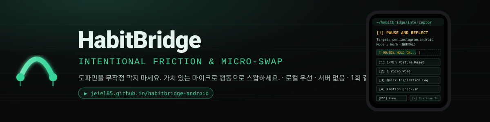

<div align="center">



# HabitBridge
### Intentional Friction & Micro-Swap · 해빗브릿지

**도파민을 무작정 막지 마세요. 가치 있는 마이크로 행동으로 스왑하세요.**
로컬 우선 안드로이드 스크린타임 앱의 제품·시스템 설계서(PRD/SDD)와, 그 정책 엔진과 개입 UX를 브라우저에서 체험하는 폰 시뮬레이터

[](https://jeiel85.github.io/habitbridge-android/)
[](docs/PRD-SDD.md)
[](https://github.com/jeiel85/habitbridge-android/actions/workflows/ci.yml)
[](LICENSE)

**▶ 지금 체험: <https://jeiel85.github.io/habitbridge-android/>** · 설치 없음 · 모든 데이터는 브라우저에만 · 한국어/English

</div>

---

## 이 저장소는 무엇인가

《Opal》, 《One Sec》, 《ScreenZen》 같은 디지털 디톡스 앱이 왜 퍼지고 왜 2주 안에 지워지는지를 분석하고, 그 결함을 넘는 제품을 설계한 프로젝트입니다.

| +α | 한 줄 |
| :-- | :-- |
| **차단 → 스왑** | 인스타·유튜브·틱톡을 켜는 순간 3~5초 멈춤. 그 화면에서 **1분 자세 리셋 · 단어 1개 · 영감 퀵 메모 · 감정 체크인** 중 하나를 1탭으로 실행하고 홈으로 |
| **상황 인지형 스마트 쉴드** | 취침·회의 중은 우회 불가, 업무 시간은 5초, 일상은 3초. 우회하면 10분은 조용히, 한 시간에 6번 넘게 열리면 오히려 완화(마찰 피로 방지) |
| **100% 로컬 · 서버 없음** | INTERNET 권한 없음. Room DB에만 저장, 메모는 `.md`로 내보내기 |
| **1회 결제 · 오픈코어** | 구독·광고·데이터 판매 없음. 정책 엔진과 UX는 공개 소스 |

설계서의 규칙과 수치(`docs/PRD-SDD.md` §4~§5)는 코드(`src/data.js`, `src/engine.js`)와 같은 값이며, 정책 엔진은 안드로이드 `:core:policy` 모듈로 1:1 포팅하도록 순수 함수로 짜여 있습니다.

## 데모에서 해볼 것

1. 폰의 **Instagram** 아이콘을 누르면 터미널풍 인터셉터가 뜹니다. 5초 대기 후 `[>] 앱 계속하기`가 열립니다.
2. 오른쪽 **상황 시뮬레이터**에서 시각을 00:40으로 옮기거나 "회의 중"을 켜 보세요. 쉴드가 HARDCORE가 되어 우회 버튼이 잠깁니다.
3. 스왑 4종 중 하나를 완료하면 홈으로 돌아가고 대시보드의 Focus Score·절약 시간이 오릅니다.
4. 우회해서 앱에 들어가면 10분 쿨다운이 걸립니다. `+10분`을 누르면 다시 개입합니다.
5. 앱별 **할당량**을 넘기면(사용 `+10` 버튼) 모드가 "할당 소진"으로 바뀌며 우회가 막힙니다.
6. **공유 카드** PNG와 **Notes_YYYYMMDD.md**를 내려받을 수 있습니다. 어디로도 전송되지 않습니다.

## 프로토타입 범위

| 구현됨 (브라우저) | 설계만 확정 (안드로이드 구현 대상) |
| :-- | :-- |
| 개입 판정: 허용 목록, 쿨다운, 할당 소진, 시간당 상한 완화 | UsageStatsManager 폴링 + 접근성(선택) 감지 |
| 상황 인지 쉴드(취침·회의·업무·일상), 앱별 AUTO/고정 쉴드 | `TYPE_APPLICATION_OVERLAY` 오버레이, 홈 복귀 폴백 |
| 인터셉터 화면(대기 바, 우회 잠김 표시), 스왑 4종 완료 조건 | Room 스키마·마이그레이션, MediaStore 익스포트 |
| 대시보드(Focus Score, 연속 일수, 유형·감정 분포), 공유 카드 PNG, .md 내려받기 | 온보딩·권한 플로우, 포그라운드 서비스, OEM 대응 |
| KR/EN, localStorage 저장, 엔진 테스트 11건, CI | Play 정책 체크리스트, 결제 |

## 문서

| 문서 | 내용 |
| :-- | :-- |
| [`docs/PRD-SDD.md`](docs/PRD-SDD.md) | **설계서 v1.1.0** — 시장 분석, 가치 제안, 개입·쉴드·상황 규칙, 스왑 명세, Focus Score, 권한 플로우, 엣지케이스, Room 모델, 안드로이드 아키텍처(감지 경로·오버레이·홈 복귀·배터리·프라이버시), 수익 모델·Play 정책, 검증 계획, 리스크 |
| [`docs/CHANGELOG.md`](docs/CHANGELOG.md) | v1.0.0 → v1.1.0에서 **무엇을 정정했는지** (접근성 단일 경로의 정책 리스크, 오버레이 플래그, 백그라운드 홈 복귀, INTERNET·결제 모순 등) |
| [`docs/DECISIONS.md`](docs/DECISIONS.md) | 되돌리기 어려운 결정 7건 |
| [`docs/BACKLOG.md`](docs/BACKLOG.md) | 미뤄둔 개선점 |
| [`docs/archive/`](docs/archive/) | 2026-09-09 원본 설계서·패키지 README (내용 무수정 보관) |

## 로컬 실행 · 테스트

```bash
git clone https://github.com/jeiel85/habitbridge-android.git
cd habitbridge-android
python -m http.server 8080        # 또는 npx serve .
# → http://localhost:8080
```

```bash
npm test                          # 정책 엔진 테스트 (Node 20+)
```

## 저장소 구조

```
index.html, styles.css   폰 시뮬레이터 UI (GitHub Pages 루트)
src/data.js              쉴드·상황·기본값·앱 카탈로그·단어 덱 — 단일 진실 원천
src/engine.js            순수 정책 엔진 (decide / evaluateContext / stats / focusScore / notesMarkdown)
src/app.js               컨트롤러·렌더링·시뮬레이터 시계·저장
src/i18n.js              한국어/영어 문자열
tests/engine.test.js     node:test
docs/                    설계서와 부속 문서
```

안드로이드 앱 코드는 스프린트 1에서 `android/`에 추가됩니다(설계서 §10.2).

## 로드맵

- **P0 (완료)**: 정책 엔진·UX를 브라우저 시뮬레이터로 검증, 라이브 데모 공개
- **P1**: 내부 APK 5명 7일 — 감지 지연·오버레이·배터리
- **P2**: 클로즈드 테스트 20명 14일 — 2주 유지율 ≥ 60%, 권한 유지 ≥ 80%, 스왑 비율 ≥ 40%, 가격 설문
- **P3**: 프로덕션 100명 — 리뷰 사유·환불률

## 고지

《Opal》, 《One Sec》, 《ScreenZen》은 각 권리자의 제품이며 이 프로젝트는 이들과 무관한 독립 기획입니다. 데모는 실제 앱을 차단하지 않고 사용 시간만 시뮬레이션합니다. 라이선스: [MIT](LICENSE)

---

<details>
<summary><strong>English</strong></summary>

### HabitBridge — Intentional Friction & Micro-Swap

A product/system design document (PRD/SDD) for a **local-first Android screen-time app**, plus a browser **phone simulator** that runs the exact policy engine and interceptor UX described in it.

**▶ Try it: <https://jeiel85.github.io/habitbridge-android/>** (no install, everything stays in your browser, KR/EN)

**Pitch.** Blocking apps fail for two reasons: the void after the block (you drift to another feed) and friction fatigue (a 5-second pause in front of your messenger during a meeting). HabitBridge keeps the pause but fills it with a **one-tap micro-swap** — a 1-minute posture reset, one vocabulary card, a one-line inspiration note, or an emotion check-in — and adapts the shield to context: no bypass during sleep hours or calendar events, 5 s during work hours, a 3 s reminder otherwise. A bypass earns 10 quiet minutes, and more than six intercepts in an hour *softens* the shield instead of nagging harder. No `INTERNET` permission, no server, pay once.

**What the prototype implements.** The decision rules (allow list, cool-down, daily quota exhaustion, friction-fatigue guard), context-aware shields, the terminal-style interceptor with a locked bypass under HARDCORE, all four swaps with completion conditions, a dashboard with an explicit Focus Score formula (70 % swap ratio + 30 % quota adherence) and streaks, a 1080×1920 share card (PNG), Markdown note export, KR/EN, localStorage persistence, 11 engine tests and CI.

**What v1.1.0 corrected in the original.** Foreground detection moved from an accessibility-service-only design to UsageStatsManager as the primary path (Google Play accessibility policy risk); the overlay's `FLAG_NOT_TOUCH_MODAL` was dropped; returning home now uses `performGlobalAction(HOME)` when available because background activity starts are restricted; the "no INTERNET permission vs in-app purchase" contradiction is resolved (Play Billing talks through the Play Store app); saved time is derived from settings instead of being stored per log; shield levels became an enum with an AUTO (context) value; cool-down, context priority, HARDCORE behaviour and the Focus Score were defined. See [`docs/CHANGELOG.md`](docs/CHANGELOG.md).

**Docs.** [`docs/PRD-SDD.md`](docs/PRD-SDD.md) (Korean, v1.1.0), [`docs/DECISIONS.md`](docs/DECISIONS.md), [`docs/BACKLOG.md`](docs/BACKLOG.md). Run locally with any static server; tests with `npm test` (Node 20+).

**Disclaimer.** Opal, One Sec and ScreenZen belong to their respective owners; this is an independent design study. The demo blocks nothing and only simulates usage time. MIT licensed.

</details>
